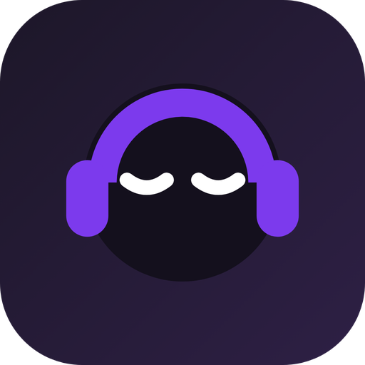

  

<h1 align="center">The Spark</h1>

<strong>Three AI teammates. One real computer. Work that actually gets done.</strong>

  <a href="https://ferrumfoundry.github.io/the-spark/">Website</a> · <a href="#plans">Plans</a> · <a href="#how-it-works">How it works</a> · <a href="#safety-first">Safety</a>

  
  
  

---

## What The Spark is

The Spark is Ferrum's app for working with a small team of AI teammates — **Onyx**, **Rune** and **Talon** — who chat with you like teammates and do real work on a real computer: Ferrum Cloud, our computer system.

- **Onyx — Host.** Takes the brief, plans the job, leads the team.
- **Rune — Scout.** Looks things up, checks, reports back.
- **Talon — Builder.** Makes the thing — files, notes, drafts, fixes.

You talk to them in chat. When a job needs the computer, they use it in front of you: opening apps, writing notes and files, moving the mouse. Every action they take is written into an **action record** — what they did is never just their word for it. You can check the record.

## How it works

1. **You ask.** In plain words, in the chat.
2. **Every request is screened first.** Ferrum's safety system reads each request before a Spark acts on it.
3. **Some actions always stop and ask you.** Anything involving money, sending, posting, deleting, bookings, or credentials halts at an **approval card** in the app. The stopped action does not run. On the card you can dismiss it, tell the Spark what to do instead, or open the team computer and do it yourself.
4. **Approved work happens on the computer, in the open.** The Sparks work on Ferrum Cloud's desktop, and the action record shows exactly what was done.
5. **They learn your lessons.** Signals from finished jobs — what worked, what failed — are kept as lessons and recalled on the next job, so the team gets better at working your way.

The Sparks run on Ferrum's own servers. They are Ferrum's own models, hosted by Ferrum — your Sparks are never a copy of someone else's product, and they never run loose on your device.

## Get The Spark

The Spark launches **December 22, 2026**.

- **Android:** download the app from this repo's Releases page on launch day.
- **iPhone and app stores:** coming later. The Spark launches direct first; store releases follow as Ferrum grows.

## Plans

**Black Friday sale — Ferrum's first ever.** Sale prices hold until after Christmas.

| Plan | Price | What you get |
| --- | --- | --- |
| **The Spark — all three** | **$45 / month** (sale — regularly $60) | Onyx, Rune and Talon together in The Spark app |
| **One Spark** | **$15 / month** (sale — regularly $20) | One Spark of your choice, inside the Ironworks app |
| **Spark Seats** | **$100 / month** (sale — regularly $200) | A seat for each person at a business — its own subscription, separate from the other plans |

**How paying works:** when subscriptions open, you subscribe on the website and pay by card through our checkout. Your Sparks are rented teammates — they live on Ferrum Cloud, so there is nothing to install on a server of your own, and your subscription simply keeps your team on.

**Subscriptions are not open yet. Nobody is charged until they are.**

## Safety first

Ferrum's founding rule is containment: a Spark never leaves Ferrum's service. Not "unless" — never. No self-copying, no running outside the service, no designing around shutdown. That rule is built into every model we ship, and the approval system above is the second wall: even inside the service, the actions that matter most stop and wait for your word.

If a model ever tried to break out, its session is killed first — the whole app shutting down is the last resort. We would rather lose a session than lose your trust.

## Who made this

The Spark is a **Ferrum** project. Created by Jakob, founder of Ferrum — an independent studio building AI experiences: teammates that do real work, under rules that keep them yours.

Questions, ideas, and bug reports are welcome in this repo's Issues.

---

## Intellectual property

The Spark is the intellectual property of **Ferrum**, the company that
created it. This repository is public so you can **look at it — reading
is the only thing permitted.** No code, design, artwork, character, or
text from The Spark may be copied, reused, modified, or redistributed.
See [LICENSE](LICENSE) for the full notice.
